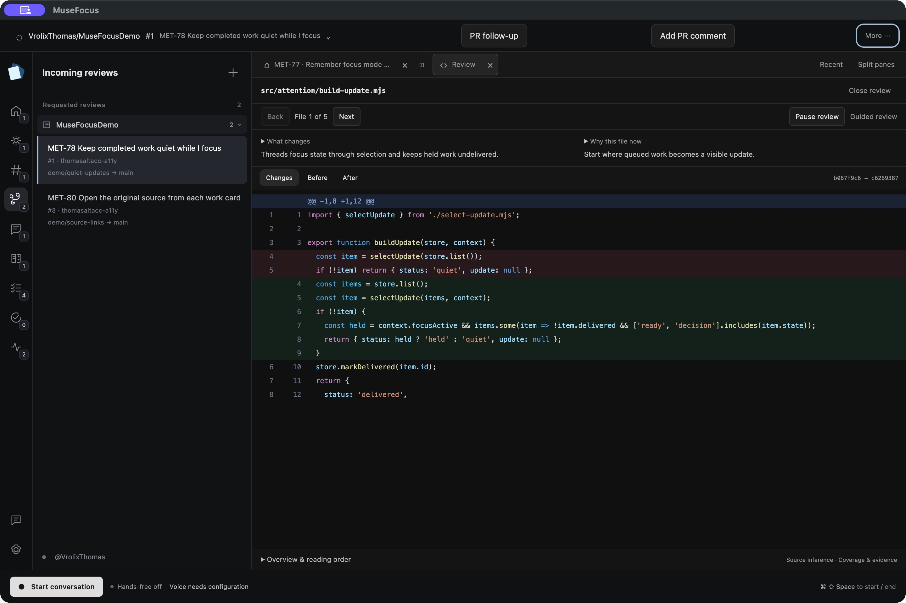
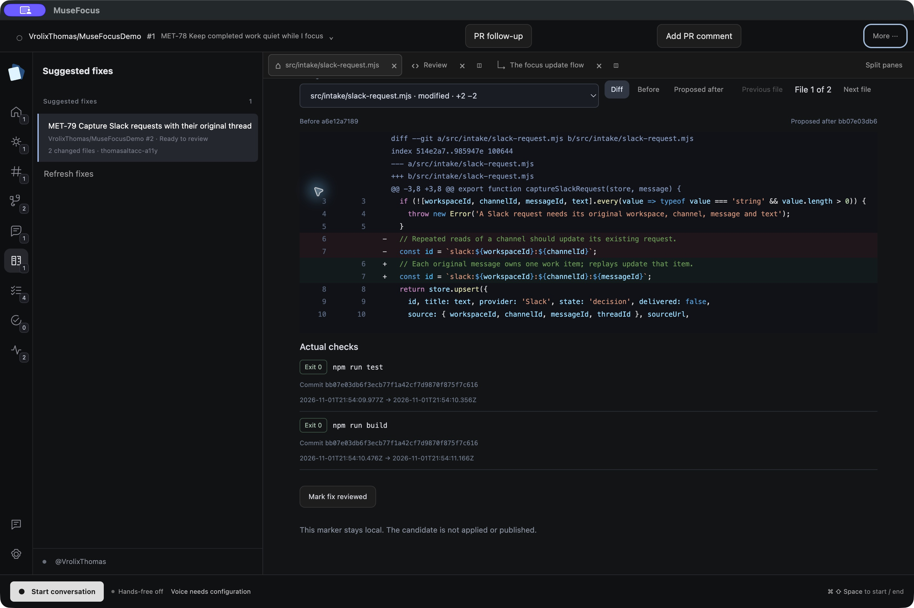
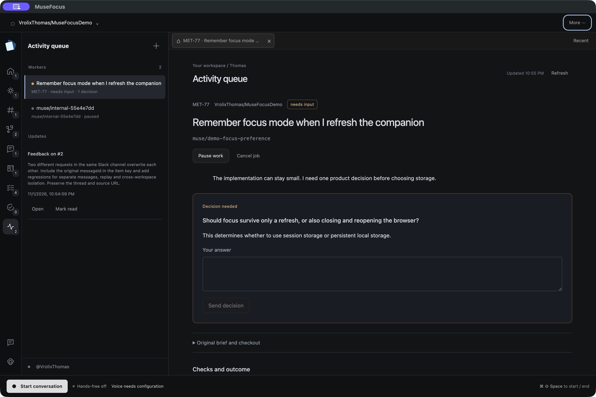
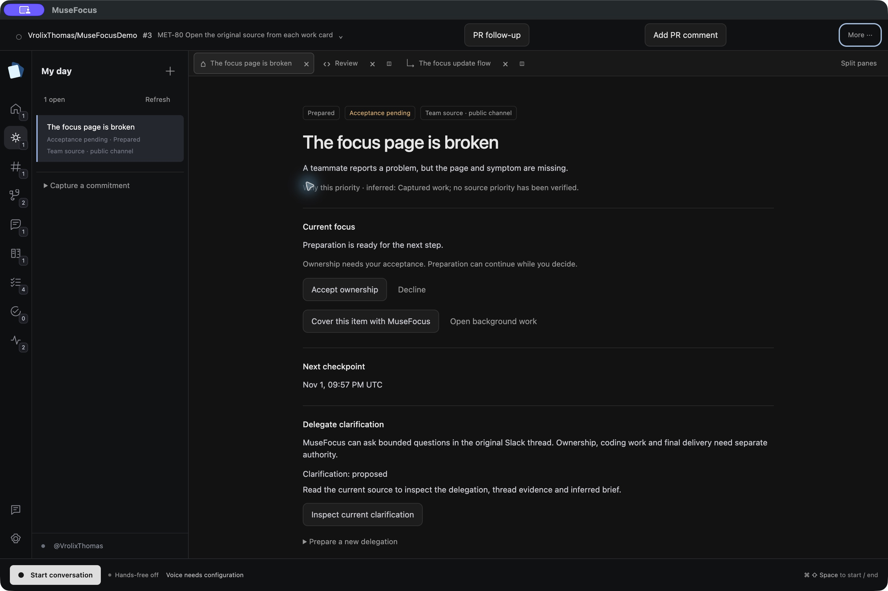

<p align="center">
  
</p>

<h1 align="center">MuseFocus</h1>

<p align="center">
  <b>A voice-first command center for engineers: review PRs, triage tickets and run coding jobs by talking.</b><br>
  <a href="https://musefocus.app/"><b>⬇ Download for macOS at musefocus.app</b></a>
  · <a href="#quick-start">Run locally</a>
  · <a href="docs/user-guide.md">User guide</a>
  · <a href="https://github.com/VrolixThomas/MuseFocus/releases/latest">Latest release</a>
</p>

> **Meta Hackathon 2026.** Built from scratch during the event window (first commit 2026-10-26).
> Runtime models: **Muse Spark 1.3**, **Muse Wonder 1.0**, **Muse Image 1.0** and **Muse Voice
> Transcribe 1.0** through the Meta Model API. Bonus category targeted: **Best Agentic Use-Case**.

**More than a one-prompt wrapper.** MuseFocus is a native Electron desktop app with a multi-tool
agent loop (about 70 typed tools). The agent operates a real workspace: code diffs pinned to
exact commits, a persistent native browser, documents and diagrams. It only describes something
after the app confirms that thing is actually on screen. Speech runs in a local WebRTC sidecar
with barge-in. Background coding jobs run in isolated Git worktrees and execute real checks.
PR reviews are prepared ahead of time and cached in SQLite. Nothing is posted to GitHub, approved
or sent to Slack without exact, explicit confirmation.

<table>
  <tr>
    <td width="50%"><br><sub><b>Review.</b> Pinned source diff with an inferred reading order, walked through by voice.</sub></td>
    <td width="50%"><br><sub><b>Fix.</b> Proposed change plus actual local test/build results from an isolated worktree.</sub></td>
  </tr>
  <tr>
    <td width="50%"><br><sub><b>Decide.</b> Background jobs turn product questions into saved decisions you answer by voice.</sub></td>
    <td width="50%"><br><sub><b>My day.</b> Slack requests, Linear tickets and review queues in one prioritized brief.</sub></td>
  </tr>
</table>
<sub>Real native-window captures of the desktop app, using prepared demo data (see <a href="apps/website/public/captures/README.md">capture notes</a>).</sub>

---

## The problem

Engineers lose their day to context switching between GitHub, Linear, Slack and their editor.
Each review means reconstructing intent from a diff. Each ticket means a new branch and a cold
start. Most AI tools add one more chat window to switch to.

## What MuseFocus does

- **Talk, don't click.** Press **Start conversation** once and speak. A short pause ends your
  turn, and speaking over a reply interrupts it. Typing is optional.
- **Guided PR reviews.** Requested reviews are prepared in the background into a reading order with
  explanations. Say *"Walk me through this review"* and MuseFocus opens each file, then narrates it.
- **Real background work.** *"Start work on MET-123 in owner/repo"* runs a coding job in its own
  app-owned worktree, runs your repository's real checks and returns a diff for review. Your
  checkout stays untouched.
- **One workspace.** Code, a persistent native browser (desktop or phone viewport), documents,
  SVG mockups and Muse Image renders share split panes that the agent drives.
- **Your actual day.** Incoming reviews, feedback on your own PRs, assigned Linear tickets and
  Slack requests feed one Home brief. Optional proactive spoken updates wait until you are idle.
- **Consent is explicit.** Comments, approvals and Slack replies need confirmation bound to the
  exact text and commit. A changed head or edited draft invalidates that confirmation.

## How it uses Meta AI

| Model (Meta Model API) | Where it runs |
| --- | --- |
| `muse-spark-1.3` | Foreground conversation, tool calling, review preparation, quick coding steps |
| `muse-wonder-1.0` (high reasoning) | New background coding jobs |
| `muse-voice-transcribe-1.0` | Streaming speech-to-text in the local voice sidecar |
| `muse-image-1.0` | Raster image canvases |

All four share one `MODEL_API_KEY`. ElevenLabs provides text-to-speech output. There are no
alternate model providers and no fallback keys.

---

## Download

Get the signed macOS app at **[musefocus.app](https://musefocus.app/)** or from
[GitHub Releases](https://github.com/VrolixThomas/MuseFocus/releases/latest). On first launch,
open **Settings → Configuration** and add your keys (see [Configure](#2-configure-env)).

## Quick start

### Prerequisites

| Tool | Version |
| --- | --- |
| macOS | Apple Silicon (the voice sidecar lock is resolved for macOS arm64) |
| [Node.js](https://nodejs.org) | 22.12 or newer |
| [Bun](https://bun.sh) | 1.3.9 or newer |
| Python | 3.13 (for the voice sidecar) |
| Keys | Meta Model API key; ElevenLabs API key and voice ID for spoken replies |

### 1. Install

```sh
git clone https://github.com/VrolixThomas/MuseFocus.git
cd MuseFocus
bun install --frozen-lockfile     # also rebuilds SQLite for Electron
```

### 2. Configure `.env`

```sh
cp .env.example .env
```

Fill in the two required keys. The voice ID is prefilled with the MuseFocus default voice.
Everything else in [`.env.example`](.env.example) is optional.

```dotenv
MODEL_API_KEY=          # Meta Model API: conversation, coding, transcription, images
ELEVENLABS_API_KEY=     # spoken replies
ELEVENLABS_VOICE_ID=cjVigY5qzO86Huf0OWal   # prefilled; change to any voice your ElevenLabs account can use
```

`.env` is Git-ignored. Keys stay in the main process and never reach the renderer.
Never commit real keys. To use another file, set `METAHACKATHON_ENV_FILE=/path/to/.env`.

### 3. Set up the voice sidecar

Speech runs in a small local Python process ([Pipecat](https://github.com/pipecat-ai/pipecat)).
It streams your microphone to Meta speech-to-text, plays ElevenLabs replies over local WebRTC,
and handles interruptions. The downloadable app bundles it; from source, create its environment once:

```sh
python3.13 -m venv services/voice/.venv
services/voice/.venv/bin/python -m pip install -r services/voice/requirements.lock
```

Without it, typed conversation still works.

### 4. Build and run

```sh
bun run build
bun run --filter @metahackathon/desktop preview
```

Wait for **Voice ready**, click **Start conversation** and say *"What can you do?"*. Grant
microphone access when macOS asks. The app starts empty, with no sample data and no sign-in
required. Ordinary conversation works without GitHub, Linear or Slack.

### 5. Optional connections

| Connect | How |
| --- | --- |
| GitHub | **Settings → Sign in with GitHub**, or set `GITHUB_TOKEN`, or **Import GitHub CLI sign-in**. Then add `owner/repo` with the sidebar **+**. |
| Linear | **Sign in with Linear**, or set `LINEAR_API_KEY` for your assigned tickets. |
| Slack | **Settings → Slack → Sign in with Slack** (PKCE). Uses the [app manifest](docs/integration/slack-app-manifest.json). |
| Shared team findings | Optional Supabase backend. See [team setup](docs/integration/team-setup.md). |

OAuth app registration and callback URLs are covered in the [OAuth setup guide](docs/integration/oauth-setup.md).

## Run without API keys

The test suites replace model, GitHub and Linear responses with controlled transports. They still
drive the real built Electron UI, IPC, SQLite and Git:

```sh
bun run type-check && bun run lint
bun run test:unit
bun run test:contracts
bun run build
bun run test:integration    # empty startup, conversation, history, cancellation (simulated model)
bun run test:workspace      # native canvases, same-page browser ops, three-file review receipts
bun run test:pr-fixes       # real coding child process, real Git and validation command
services/voice/.venv/bin/python -m unittest discover -s services/voice/tests
```

More native suites are listed in [`package.json`](package.json), for example `test:executive`,
`test:attention`, `test:pr-work` and `test:day`. They do not record a microphone or call live providers.

## Measured results

Live speech providers (Meta ASR and ElevenLabs TTS) ran in the native app with a known spoken phrase
and a controlled model. Source: [`voice-preconnect-2026-10-31.json`](docs/integration/evidence/voice-preconnect-2026-10-31.json).

| Speech end → first reply audio | Run 1 | Run 2 |
| --- | --- | --- |
| Cold speech connection | 4,367 ms | 4,054 ms |
| Prepared connection (shipped default) | 1,616 ms | 1,679 ms |

Four ordinary live `muse-spark-1.3` answers completed in 1,095–1,542 ms
([voice latency deep dive](docs/integration/voice-latency-deep-dive.md)). These are small matched
samples, not a population benchmark. Methods and limits are recorded next to each result.

## Architecture

```text
┌──────────────── Electron renderer (React) ────────────────┐
│ conversation · sidebar/Home · code/browser/doc/image panes │
└───────────────▲─────────── tRPC over IPC ─────────────────┘
                │  Zod contracts (apps/desktop/src/shared/contracts)
┌───────────────┴──────────── Electron main ─────────────────────────────┐
│ agent/      Muse tool loop, walkthroughs, coding worker                 │
│ workspace   coordinator: effects acknowledged only after display        │
│ work/       background jobs in app-owned Git worktrees, PR fixes        │
│ runtime/    GitHub, Linear, Git helpers   slack/ day/ knowledge/        │
│ db/         SQLite: prepared reviews, jobs, decisions, delivery ledger  │
└──────▲─────────────────────────────────────────────▲──────────────────┘
       │ local WebRTC                                │ HTTPS
┌──────┴──────────────────┐            ┌─────────────┴──────────────┐
│ services/voice (Python)  │            │ Meta Model API · GitHub ·  │
│ Pipecat: Meta STT,       │            │ Linear · Slack · optional  │
│ ElevenLabs TTS, barge-in │            │ Supabase team sharing      │
└─────────────────────────┘            └────────────────────────────┘
```

## Repository

| Path | Contents |
| --- | --- |
| [`apps/desktop`](apps/desktop) | Electron app: main process, renderer, shared contracts, packaging |
| [`services/voice`](services/voice/README.md) | Python voice sidecar (Pipecat, WebRTC) |
| [`services/team`](services/team) | Optional Supabase sharing API (Edge function source) |
| [`supabase`](supabase) | Ordered migrations with row-level security |
| [`apps/website`](apps/website/README.md) | musefocus.app website (Next.js) |
| [`docs/user-guide.md`](docs/user-guide.md) | Full feature and configuration guide |
| [`docs/integration`](docs/integration) | Acceptance reports, evidence and setup guides |

## Built with

Electron · React · TypeScript · Bun · Turborepo · tRPC · Zod · SQLite · Python · Pipecat · WebRTC ·
Meta Model API (Muse) · ElevenLabs · Supabase · Next.js
