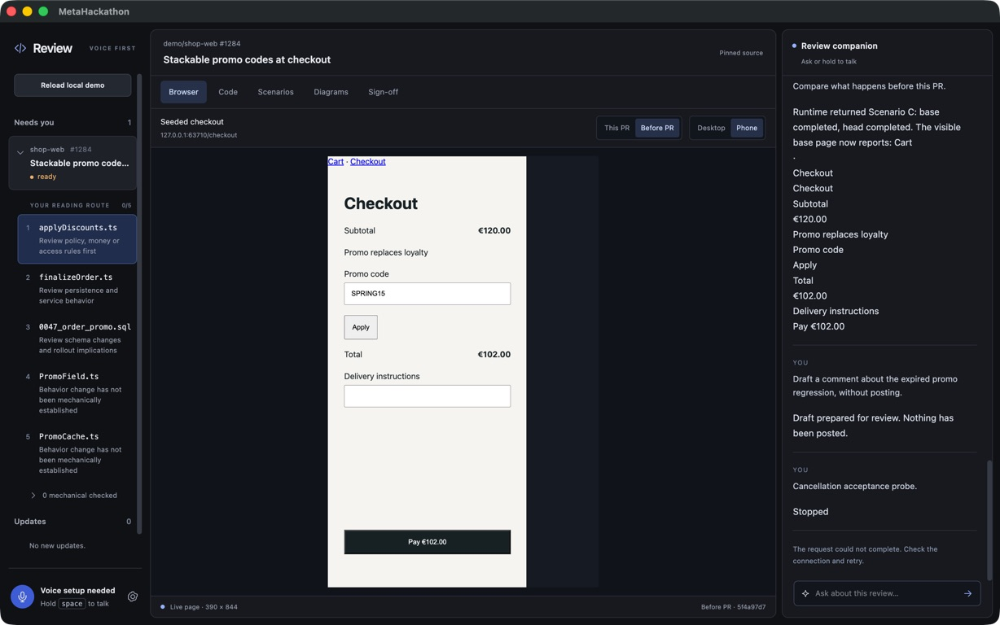

# Conversational review acceptance — 2026-10-27

Historical pre-V1 browser-demo acceptance. The current product is documented in
[V1 acceptance](v1-acceptance.md); commands below apply to the tested historical source.

The local slice passed in the combined `hack/integration` application. The tested source is
`030b2e5`; subsequent handoff documentation does not change application behavior.
All native launches and assessment took place in the integration checkout.

## Launch

```sh
cd /Users/Werk/Documents/Repositories/MetaHackathon-worktrees/integration
bun run build
bun run --filter @metahackathon/desktop preview
```

Load the local demo once. Add a Meta key in Settings for live typed agent requests. For speech,
add an ElevenLabs key and accessible voice ID, then choose Prepare voice and wait for Ready.
The pinned Python environment is already installed in this checkout at `services/voice/.venv`.
See the root README for installation on another checkout. Apple signing is not needed to run
this local development application.

## Verified behavior

The seven requested sentences were submitted through the actual renderer conversation form.
An acceptance-only scripted Meta responder chose tools; the agent, IPC, native browser, source
reads, scenario execution and renderer effects were real. No model fallback ships in the app.

| Request | Observed result |
| --- | --- |
| Walk me through this PR. | Pinned source and code highlight shown. |
| Show me the checkout. | Actual head page in the main native browser, desktop 1024×768. |
| Apply the promo code. | Real form typing/submission; scripted choice SPRING15 produces €78. |
| Show it on a phone. | Same head page/webContents changes to 390×844. |
| Scroll to the payment button. | Actual scroll changes; payment button visible, never submitted. |
| Show me the code responsible. | Main surface switches to matching pinned source lines. |
| Compare what happens before this PR. | Actual base page shows €102 for the same code; Scenario C runs on both revisions. |

Scenario C's base sends two reminders (€108 and €72). The head records `PromoExpiredError`,
sends none, and stops the batch. Both trace harnesses finish successfully; this does **not** mean
the observed head behavior succeeds. All results are from the seeded demo, not a live GitHub PR.

The native check also rejects stale browser references and unconfirmed/changed-body comments,
records zero GitHub writes, suppresses late cancelled output/actions, starts the real local voice
sidecar to Ready without an audio/provider request, removes dummy credentials, and verifies
closed preview ports and removed owned worktrees at shutdown. Typed and voice identity/effect
receipts, audio interruption and ignored-action handling pass mocked transport/media tests.



The screenshot was captured from the native acceptance window. Its conversation includes the
scripted comparison and explicit cancellation/confirmation probes. Voice setup is shown as
needed because the test removes its dummy credentials before capture.

## Validation and limits

Type-check, lint, build, 314 TypeScript behavior tests, 13 Python voice tests, 12 provider-harness
tests, two packaging regressions, native runtime IPC and the seven-request native browser flow
passed. Run `bun run test:integration` and `bun run test:browser-flow` to reproduce the native
checks. Detailed generated evidence lives under `apps/desktop/out/browser-flow-smoke/`;
[acceptance.json](acceptance.json) retains the portable result summary.

Live Meta model/STT, ElevenLabs TTS and microphone verification still require real credentials
and an accessible voice ID. No real GitHub comment was posted. Developer ID signing,
notarization and signed updates remain release checks; the earlier frozen voice bundle must be
rebuilt from the integrated redirect-fixed source before distribution.
