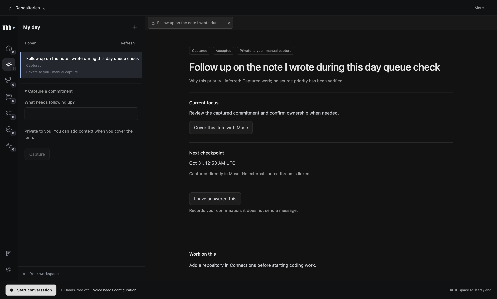

# My day, Slack and voice checkpoint — 2026-10-31

Later same-day update: Slack browser login now uses the supported desktop PKCE localhost flow.
The hosted callback blocker recorded below is superseded; see [current setup](oauth-setup.md).

Implementation checkpoint: `1028187` on `hack/integration`. Eight Codex-only SuperiorSwarm
lanes worked in separate checkouts. Their reviewed handoffs, corrections and reservations are
recorded on MET-8. Earlier UI/agent/runtime/voice branches were audited before reusing their work.
SuperiorSwarm is a development tool, not an installed-app dependency.

## Available locally

- My day: durable personal items, incoming ownership acceptance, contextual Q&A, isolated worker
  preparation/admission, ready-work review and an answer outbox. Personal source-less items use
  explicit self-attestation; Slack items require an exact original-thread delivery receipt.
- Slack Settings: main-only `.env` user-token import, actual identity verification, explicit watched
  conversations, bounded polling and optional Socket Mode. There are no product sample messages.
  Source edits/deletions fence old work, inference and replies. Account changes isolate private data.
- Private/company knowledge: durable exact recorded source context; fresh source membership and
  revision checks before retrieval. Company facts use public-channel sources only. `memory_search`
  performs literal search; `day_read_source` reads the original request and a bounded thread batch.
  Loaded evidence does not establish a displayed canvas or permission to send a message.
- Voice: default-on bounded preconnection during an explicit hands-free conversation, retained
  pre-roll and FIFO drain, cancellation, expiry and cold fallback. The connection is not kept alive
  indefinitely and does not remove live model/tool time.

## Verification

| Check | Result and scope |
| --- | --- |
| Frozen install | Passed; 553 installs checked, no dependency changes; SQLite rebuilt for Electron |
| Type-check / lint / production build | Passed |
| Full Bun suite | 1294 passed, 10 Electron-only SQLite tests skipped, zero failures |
| Actual Electron ABI SQLite | Day 5/5 and Slack 5/5 passed; knowledge adapter 10 checks passed |
| Native conversation / My day | Actual built renderer, preload, IPC and SQLite; controlled provider inputs |
| Native prepared review / workspace / executive / OAuth | Passed; controlled GitHub/Linear/model transports, actual Git/worker/browser operations where applicable |
| Native hands-free / attention | Passed with controlled media transports and explicit cold build; synthetic microphone, muted speaker |
| Actual-provider voice | Two warm/cold pairs and immediate/expiry/transient/barge-in safety cases passed; final default-on check passed |

The My day native check creates one controlled personal item through the UI, deduplicates a replay,
checks real source/frame acknowledgements, confirms its personal answer and verifies SQLite reopen
after shutdown. It does not prove a live Slack send or run a coding child. Existing executive native
acceptance runs the app-owned Git worktree and worker with controlled upstream providers.



Voice end-of-generated-phrase → first PCM was 5056/4735ms cold versus 2296/2370ms warm in two
matched pairs. The final default-on run measured 2464ms. ASR/TTS providers were live; the model was
controlled and the phrase generated. These are conditional local observations, not a p95 benchmark,
physical microphone/acoustic verification or fully live conversational latency. Numeric evidence:
[`voice-preconnect-2026-10-31.json`](evidence/voice-preconnect-2026-10-31.json).

## Remaining acceptance and external dependencies

At this checkpoint, live Slack still required the selected workspace, granted user connection and
appropriate scopes. The earlier hosted-callback assumption was subsequently corrected: desktop
PKCE uses localhost without a relay. Developer token import remains an optional alternative.
Provider rate limits can defer source reads; polling cannot guarantee observation of every deletion.

The complete live Slack → acceptance/Q&A → coding worker → review → original-thread answer still
needs the user's populated sources. MET-66/67/68/69/71 remain In Progress for that integrated scope.
The earlier review audit MET-70 is complete. MET-51 remains open for longer-idle cold latency and
fully live, human-spoken validation; preconnection is one measured improvement.

Supervision continues without a window while the Mac is awake. Sleep/offline pauses and checkpoints;
fully quitting the app stops local supervision. No hosted company service or cross-employee transport
is deployed. The local trusted agent directory currently admits the connected user's Muse only.

## Launch

```sh
cd /Users/Werk/Documents/Repositories/MetaHackathon-worktrees/integration
bun run build
bun run --filter @metahackathon/desktop preview
```

The active development configuration remains the main repository `.env`; GitHub/Linear OAuth grants
remain in private user data. Use Start conversation once; no PR or held button is required. Use
Settings → Slack for its configuration. `bun run test:day` reproduces the personal-queue native check.
