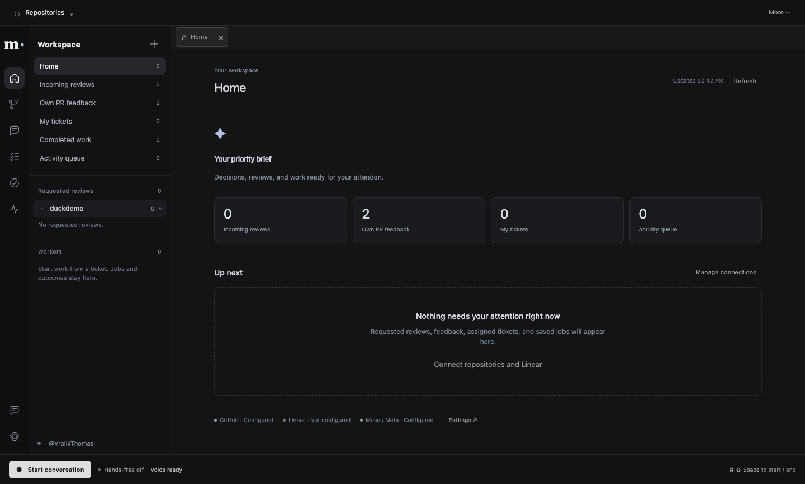
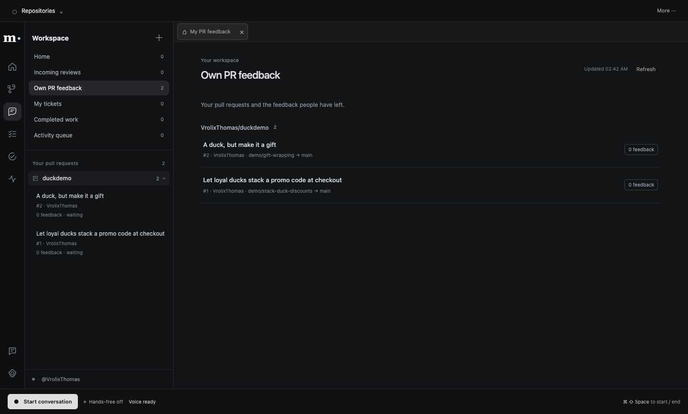
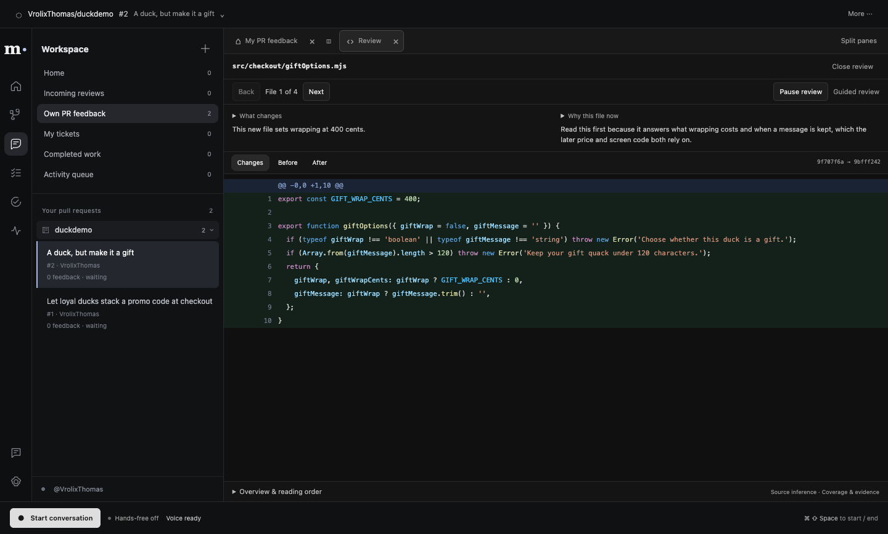

# Executive center acceptance — 2026-10-29

The integrated app now opens a real priority brief with a persistent navigation rail and grouped
repositories. Requested incoming reviews are separate from feedback on the user's own PRs. Own
Linear tickets, independent worker jobs, decisions and completed outcomes share that workspace.
Transcript/typing remains optional and the hands-free controls remain available everywhere.

## Implemented behavior

- GitHub uses the configured token or imports the existing GitHub CLI login. Users add repository
  names or local clones; queues use actual account/repository/PR/review APIs. Preparation runs in
  the background per repository. Readiness and failures are shown; failed preparation can be retried.
- Linear uses `LINEAR_API_KEY` in the main-only `.env`. Scopes are user selectable; assigned active
  tickets in selected teams or projects form the ticket list. No synthetic tickets enter the app.
- Starting work creates a durable job, app-owned Git copy/worktree and independent Muse child.
  Foreground cancellation does not cancel workers. Product/convention questions persist until
  answered. A revision continues the same job and records fresh actual commits/check results.
- A completed job exposes its actual diff, source and command log. Acceptance binds to the current
  head and only then completes its real linked Linear ticket. Draft publication is a separate action;
  checked revisions update the existing app-owned branch without force-pushing. No automatic merge.
- Own-PR suggestions can start independent work. Automatic application requires anchored feedback,
  successful recorded checks, current GitHub head and a separate inferred assessment. Product
  ambiguity becomes a decision. The preference can be disabled.
- Exact source canvases and stitched flow artifacts can include unchanged files. Main reads the
  source at full commit SHA; text/path/line identity stays exact. Relationships and order are inferred.
  Local search keeps base/head identity and requires that commit to be available locally.
- Jobs, decisions, checkpoints and artifacts are saved privately. Shutdown pauses active jobs;
  reopening schedules shutdown-paused work. Explicit pauses and unanswered decisions remain paused.
  The existing native browser remains the same page controlled and observed by the foreground agent.

## Live checks

The app was launched from `hack/integration` with isolated user data and the existing main-checkout
configuration. Live GitHub returned account `VrolixThomas` and two actual open `duckdemo` PRs. The
own-feedback section listed both, and PR #2 opened with actual pinned, highlighted source. A real
Muse foreground turn opened Home and accurately reported 0 incoming reviews, 2 own PRs and missing
Linear access. This was a typed renderer turn through the same conversation service used by voice.
The check permitted read-only GitHub and made zero GitHub writes.

A separate live Muse coding check used seven model requests to inspect an owned temporary repository,
edit actual CommonJS source and run its actual `npm run test` successfully. Its source/task was
controlled test data; it was not a real Linear-ticket run. No speech recording was made in these checks.





## Controlled behavior checks

`bun run test:executive` starts the actual built default Electron renderer/preload/IPC and a real child
coding process. GitHub, Linear and model responses are controlled inside the harness, never product
fallbacks. It creates a real isolated bare repository/worktree, asks/answers a decision, resumes the
checkpoint, changes actual source, commits and runs the declared check on that exact commit.
A third child revises the same job/worktree, records a new head/check, rejects an old-head approval,
and accepts the current loaded diff through the UI. SQLite reconnect plus renderer reload retain the
job, accepted state and exact diff; staged/unstaged/untracked original work is preserved. No GitHub write.

Native V1, prepared-review, workspace and hands-free checks also pass. They cover general conversation,
history/cancellation, exact pinned source/highlighting, review display/playback gates, real native
browser operations and layout, buffered PCM, interruption and modal Escape behavior. Speech/model
transports in those checks are simulated. The Python voice suite covers its transport/provider adapters.
Full process quit/reopen of a running job and fresh live microphone/provider round-trip remain separate
manual acceptance checks; SQLite reconnect and renderer reload do not prove those.

## Setup and remaining limits

From the integration checkout:

```sh
bun run build
bun run --filter @metahackathon/desktop preview
```

The configuration file on this machine is
`/Users/Werk/Documents/Repositories/MetaHackathon/.env`. Add `LINEAR_API_KEY`, reload Settings and
choose scopes to exercise live assigned tickets. The missing key blocks only live Linear verification.
Click Start conversation once after Voice ready; speak normally and interrupt a reply by talking.

Review-comment publication is still draft-only in the current prepared-review UI; no comment is posted
without an exact confirmed-comment flow. Team GitHub login/webhooks, cloud/Supabase hosting, raster
image generation, signing/notarization and background execution while the app is fully closed remain
outside this local increment. Worker commands run with user OS permissions; this is worktree isolation,
not an OS sandbox. Repositories without configured checks are not reported as validated.

Coordination, reservations and handoffs: Linear MET-8, MET-46–49. SuperiorSwarm was used for Codex-only
development dispatch; the distributed app runs its own workers and does not require SuperiorSwarm.
