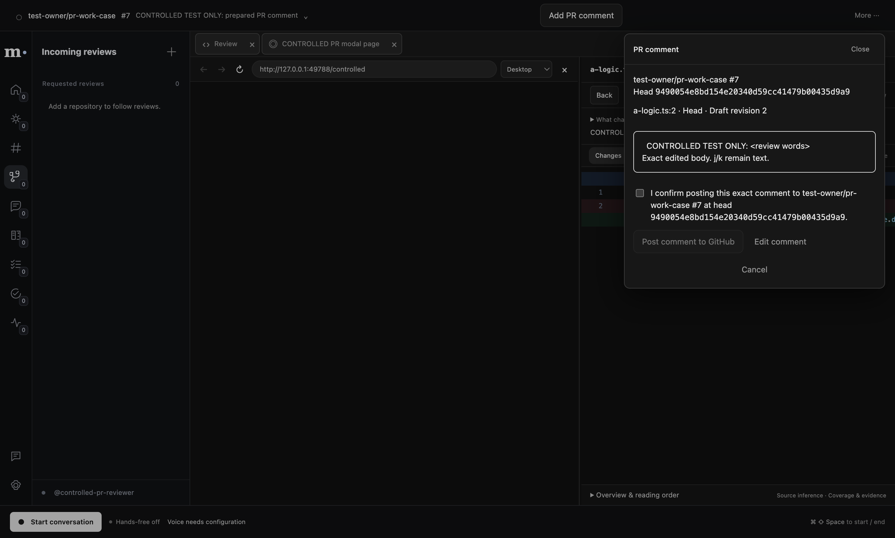
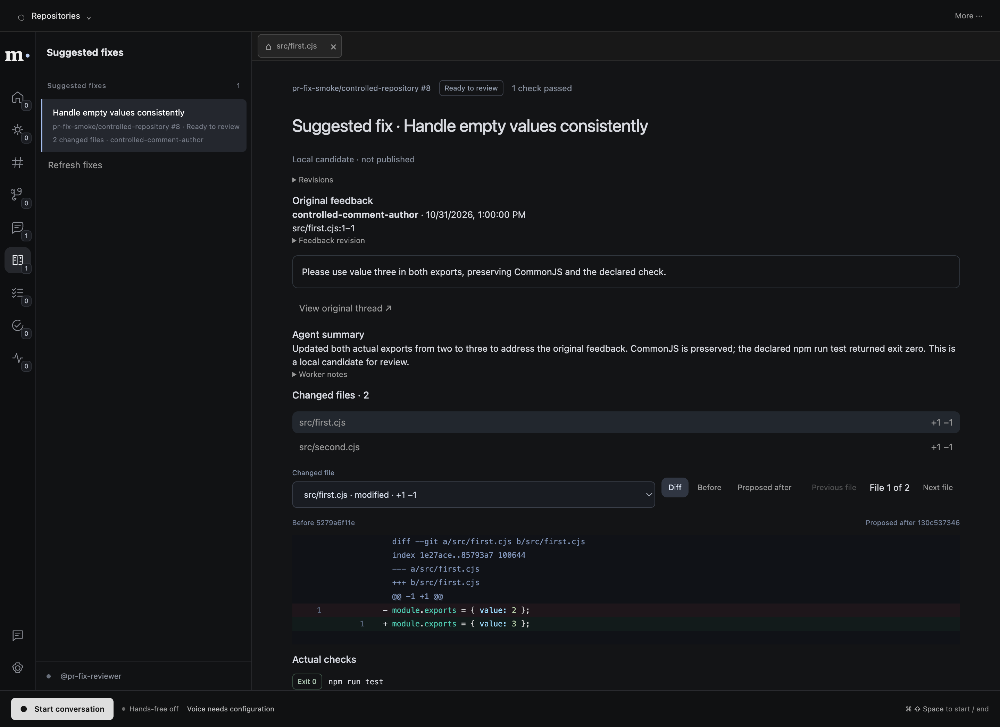

# Prepared PR comments and reviewable fixes — 2026-10-31

The integration now binds prepared-review file navigation, confirmed GitHub comments and an
independent local proposed-fix queue. Product startup uses real accounts and sources; test records
exist only in isolated acceptance profiles.

## Reviewer flow

- Open a prepared PR. **j / k** follows its prepared reading order; typing, menus, dialogs,
  composition and endpoint keys retain their own behavior.
- **Add PR comment** prepares the exact body and optional single head-side diff anchor.
  Review/edit clears consent. Posting requires an unchecked explicit confirmation of the exact
  current draft revision/body/head. Cancellation owns main preflight work; unknown submissions
  retain their original request identity and the runtime posting ledger.
- On **Own PR feedback**, choose **Prepare suggested fix** or ask Muse to prepare the inspected
  source. A separate app-owned coding child reads/edits an isolated Git checkout and main records
  actual checks at the candidate commit. Foreground interruption does not own its lifetime.
- **Suggested fixes** shows original feedback, an inferred explanation, changed files, line counts,
  syntax-highlighted diff, **Before**, **Proposed after**, Previous/Next and actual check receipts.
  Full revision hashes and worker notes are available in disclosures.
- **Mark fix reviewed** records the exact locally inspected candidate head. The candidate remains
  local and unpublished; this marker grants no PR-author approval, applies no patch, sends no reply
  and completes no Linear ticket.

Both manual and agent navigation use the shared workspace coordinator. `fixSource` pins the actual
candidate ID/base/head/file. The renderer loads current authorized detail and commits two matching
visible frames before main accepts the effect. Status-only metadata is separate from source proof.
Source-line actions resolve immutable app-owned candidate text, preserving exact bytes and lines.

## Verified scope

- Type-check, lint and production build passed. Full Bun run: **1561 passed, 13 Electron-only
  checks skipped, zero failures**, with a 20-second per-test budget for real local Git operations.
- Existing native OAuth, conversation, My day, prepared-review, workspace/browser and executive
  gates passed. Hands-free and proactive attention regressions passed with controlled media.
- `test:pr-work` passed against the actual built App/preload/IPC, real local Git and a native
  loopback browser page. It verifies keyboard/typing guards, exact draft/edit/consent, native page
  hiding during modal resize, one confirmed controlled GitHub POST, durable same-ID replay,
  actual provider-preflight cancellation, renderer reload and moved-head rejection.
- `test:pr-fixes` passed with the actual PR-fix supervisor, coding entry child, Git isolation,
  two source edits, actual declared npm check and main finalization. Four real accepted source
  receipts follow matching app frames. Both files' diff/Before/Proposed after, local review marker,
  0600 private-store reopen, unchanged original HEAD/refs/index/staged/dirty/untracked bytes and
  zero GitHub writes were verified.
- A real foreground typed ConversationService turn listed and inspected the local candidate, opened
  its second file through the shared workspace tools, then explained it only after a matching
  session/turn/action receipt and two actual visible app frames. Provider/model responses remained
  controlled; source inspection alone did not establish display. Concurrent UI/agent/local-review
  reads now serialize the same candidate’s strict Git lock, covered across service instances.

GitHub/model responses in these native checks are controlled provider inputs. No service success,
worker result, runtime patch, UI marker or positive acknowledgement is fabricated by the harness.
These checks do not establish live speech, live GitHub posting, a full process restart of a running
fix, hosted execution, uncertain-worktree resume or a clarification-answer API for this new queue.
Interrupted/needs-input attempts and their files remain retained and explicit.

The normal app also reopened with the existing real GitHub/Linear/Slack accounts, real queues and
an empty Suggested fixes queue. Current real PRs had no feedback; no sample fixes or comments were
inserted into them. The separate logo/companion study remains under design review.





Numeric evidence: [pr-work-2026-10-31.json](evidence/pr-work-2026-10-31.json).

## Reproduce

```sh
cd /Users/Werk/Documents/Repositories/MetaHackathon-worktrees/integration
bun run test:pr-work
bun run test:pr-fixes
bun run --filter @metahackathon/desktop preview
```

Root alone runs combined/native acceptance. New private fix state is stored under user data
`work/pr-fixes/`, isolated by the actual GitHub account. It does not enter the regular worker's
feedback auto-apply path. Existing real source/review caches remain in SQLite.
