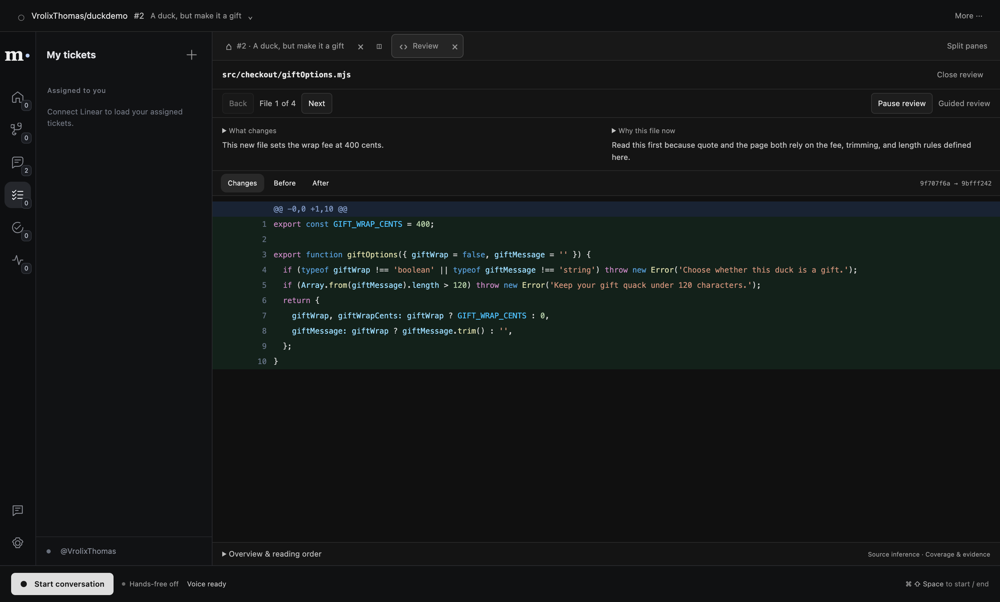
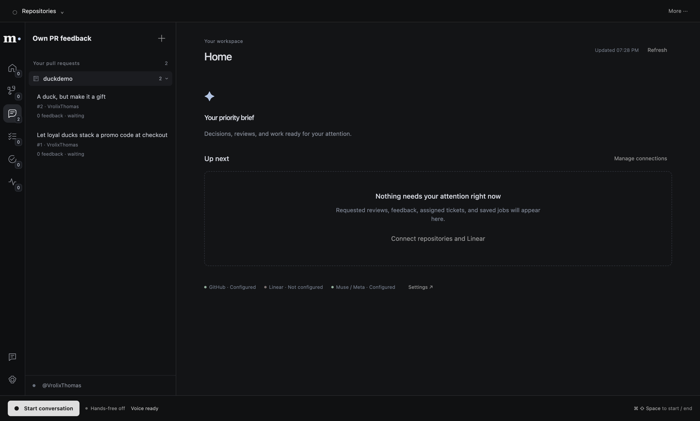

# Sidebar and account connections — 2026-10-30

MET-52 removes duplicate navigation. The rail selects one contextual sidebar list; browsing a
category leaves the displayed review, browser or draft in place. Selecting an item opens it.
Home keeps its executive brief; its sidebar lists actual recent canvases. Generic category tabs
and repeated main-pane lists are removed. Agent and manual navigation share acknowledged commands.

The main/renderer receipt protocol separates sidebar revisions from content revisions. Sidebar
browsing does not cancel foreground speech or detach/hide the native browser. Content changes
still invalidate stale receipts. An in-flight display acknowledgement settles before queued
sidebar browsing applies.

MET-53 adds GitHub and Linear browser OAuth. Both feed existing source and worker adapters,
preserving manual-token development compatibility. Setup and exact callbacks are in
[OAuth setup](oauth-setup.md). Account changes fence outstanding reads and clear fetched queues;
OAuth metadata remains separate from secrets. Cancelled reconnects retain the prior connection
and its Disconnect control. Disconnect preserves the other provider and app registration settings.

Verified in the integration checkout:

- Frozen dependency installation, type-check, lint and production build.
- Full TypeScript suite: 979 passing tests across 115 files, including OAuth/state/PKCE/refresh/storage
  races, account queue fencing, sidebar content receipts and renderer recovery.
- Eight native built-app checks: V1, prepared review, workspace, executive work, hands-free,
  proactive attention, local browser and OAuth. Existing controlled voice checks exercise actual
  Chromium media/PCM; they do not record ambient microphone input.
- The local browser check proves sidebar browsing causes zero native hide calls and preserves
  the guest page, geometry and presented review. Actual local page interaction remains covered.
- OAuth uses actual default UI/preload/IPC, real loopback HTTP callbacks, PKCE forms, OS
  encryption, rotating Linear refresh through data clients, owner filtering, selected-provider
  disconnect, cancelled reconnect, listener shutdown and SQLite reopen. Provider transport is
  controlled. There is no fabricated successful login RPC or account-status override.
- A separate live read-only GitHub run fetched the user's real duckdemo PRs, prepared and opened
  PR #2, and browsed My tickets while retaining the same pinned review. No GitHub writes,
  live Linear requests or speech were made by that run.

Screenshots show actual live GitHub data with an isolated app profile:

The screenshot repository happens to be the user's demo repository; those records are fetched
from GitHub and are not a product fixture fallback.

Reports are generated under `apps/desktop/out/`: `oauth-smoke-report.json`,
`local-browser-smoke-report.json`, `sidebar-live-report.json` and the other named native reports.

Pending: live human OAuth approval needs the user's new client registrations in `.env`.
No live provider-consent claim is made. MET-53 stays In Progress for that acceptance step.
Physical microphone/speaker latency and Apple signing are not established by these checks.
MET-51 still tracks the separately identified voice latency contributors.
