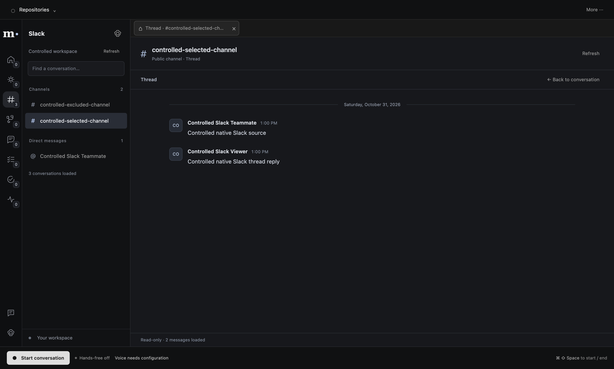

# Slack login, automatic following and reader — 2026-10-31

The standalone Electron app uses Slack’s [desktop PKCE flow](https://docs.slack.dev/authentication/using-pkce/)
with `http://localhost:43187/oauth/slack/callback`, user scopes and a public Client ID.
No embedded client secret or hosted callback is required. Setup is in [oauth-setup.md](oauth-setup.md).

## Behavior

Settings provides Sign in, Reconnect, Cancel and Disconnect. Main verifies the actual actor,
validates one-time state/S256 PKCE, and saves rotating grants with OS encryption and owner-only
permissions. Existing GitHub/Linear grants are preserved. OAuth errors never silently select a
manual Slack account. Account changes fence pending reads and clear private foreground context.

New and legacy-empty preferences follow all joined active channels and DMs automatically.
Membership discovery is paged, durable and refreshed; exclusions are optional. Existing nonempty
manual selections retain their selected mode. Removal waits for complete membership discovery;
partial/error pages cannot claim completion. Intake starts from a bounded recent window, preserving
its origin through rate limits and restarts. This is not an exhaustive Slack archive.

The Slack sidebar groups actual channels and named DMs. Read-only canvases show actual message
pages, observed author labels, older pages and threads. Opening a source loads its exact identity
before committing two visible frames and acknowledging it to main. Agent read tools return bounded,
untrusted source data and navigation proposals; reads alone never prove display or permit sending.
Confirmed Day replies remain separate. No message composer or product fixtures were added here.

Reader metadata does not depend on watcher startup. Live Slackbot compatibility allows the system
peer omitted from the returned member list; the connected human must still be an observed member.
Only explicit `SLACK_INTERNAL_APP=1` enables internal-app pacing. Commercial/default pacing remains
conservative, and provider Retry-After is always respected.

## Verified

- Full Bun suite: **1425 passed, 13 Electron-only checks skipped, zero failures**, before the final
  narrow Slackbot correction; its focused provider/reader regression also passed.
- Type-check, lint and production build passed. Actual Electron SQLite Slack adapter checks: **8 passed**.
- Controlled native acceptance used the actual built App, preload/IPC, HTTP callback, OS encryption,
  automatic joined following, exclusion settings, and populated channel → thread → channel navigation.
  Three actual message RPC pages and three accepted display receipts retained exact source, text and
  observed author identity. Two distinct matching app frames preceded each receipt. No successful RPC
  response, rendering acknowledgement or source-store record was supplied by the harness.
- Existing native GitHub/Linear OAuth, conversation, Day, prepared reviews, workspace/browser,
  executive workers, hands-free and attention gates passed. Provider/model/media inputs are controlled.
- Separately, live browser authorization succeeded, the encrypted Slack grant survived a full normal
  app restart, and the actual workspace discovered/followed **12 joined conversations** (4 channels,
  8 DMs) without manual selection. Two opened live channel history requests and the corrected Slackbot DM returned no messages.
  The Slackbot canvas opened successfully in the normal app after the fix.

The populated screenshot below uses controlled Slack responses. Live registration/consent and
membership discovery are verified separately; populated live history, source → worker → confirmed
reply delivery, Socket Mode, physical microphone and live speech are not established by this check.
No messages were posted to the real workspace. MET-66 remains In Progress for broader intake/delivery
acceptance. Private workspace screenshots and response bodies are not committed.

Scope and numeric evidence: [slack-oauth-2026-10-31.json](evidence/slack-oauth-2026-10-31.json).
Reproduce with `bun run test:slack-oauth` from integration. Root alone runs combined native checks.
