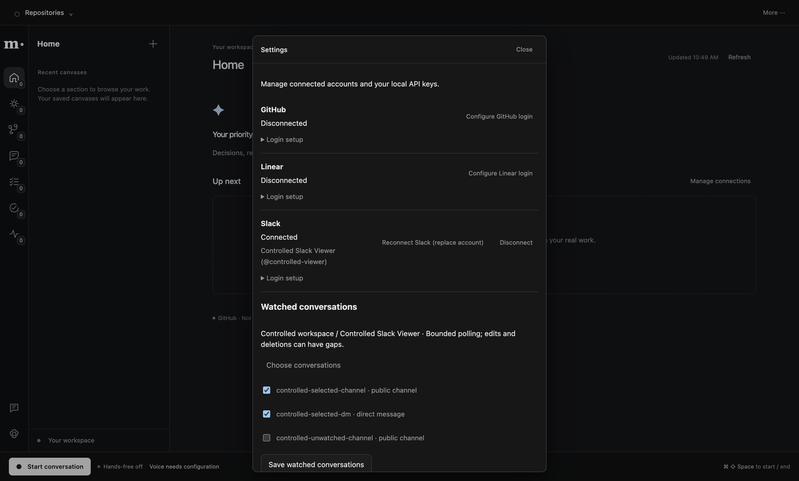

# Slack desktop login — 2026-10-31

Implementation: `ecb111f`, after reviewed Codex core/UI/native handoffs. Uses the current
[Slack desktop PKCE flow](https://docs.slack.dev/authentication/using-pkce/) with the exact callback
`http://localhost:43187/oauth/slack/callback`, user scopes and Client ID only. The earlier HTTPS-only
restriction was too broad and is superseded. No hosted callback or embedded client secret is needed.

## Behavior

Settings offers Sign in, Reconnect, Cancel and Disconnect for Slack. Browser authorization uses
one-time state and S256 PKCE; the callback listener is bound to loopback with exact Host/path/state
checks. Main verifies the actual workspace/user and stores the grant in the existing OS-encrypted
account file. Old GitHub/Linear envelopes remain compatible and their ciphertext is preserved when
Slack is added or removed. Rotating tokens retain the connection identity used by sources/outboxes.

OAuth takes precedence over the optional developer user token. Refresh, storage or account failures
do not fall back silently to a different manual account. Account/workspace changes clear current
foreground context and private Day selection, fence old reads, and keep background work separate.
Shutdown drains account transitions before closing shared storage.

Sign-in alone imports no conversations. After connecting, explicitly choose channels/DMs to watch.
Private source access/revision checks remain in the provider and knowledge boundaries; user scopes
do not make every message company knowledge. Posting remains a separately confirmed Day reply.

## Verified

- Full Bun suite: **1328 passed, 10 Electron-only SQLite tests skipped, zero failures**.
- Type-check, lint and production build passed; 138 focused OAuth/provider/UI checks passed.
- Actual built Electron UI/preload/IPC and real HTTP localhost callback passed against controlled
  Slack transport: login/cancel, invalid state rejection, PKCE binding, verified source actor,
  OS-encrypted owner-only grant, channel/DM watch selection, reconnect cancellation, disconnect
  and pending-login shutdown. No successful RPC response was replaced.
- Existing native GitHub/Linear OAuth, conversation, Day, prepared review, workspace/browser and
  executive worker gates passed. GitHub/Linear tests still use controlled provider responses.

This does **not** establish live Slack registration/consent, message ingestion/posting, human speech
or process restart. The native Slack test uses one isolated profile and controlled user records.
Its preservation check covers disconnected GitHub/Linear metadata; encrypted cross-provider byte
preservation is additionally covered by store tests. Existing OAuth native acceptance verifies the
actual GitHub/Linear encrypted login/refresh/disconnect behavior independently.

Numeric/native scope evidence: [slack-oauth-2026-10-31.json](evidence/slack-oauth-2026-10-31.json).
Reproduce with `bun run test:slack-oauth` from integration. Root alone runs combined native checks.

## Live setup remaining

The active `.env` has no Slack app Client ID and Chrome is awaiting the user's Slack sign-in.
Create the dedicated app using [slack-app-manifest.json](slack-app-manifest.json), put its Client ID
in `SLACK_OAUTH_CLIENT_ID`, then authorize through Muse. See [setup](oauth-setup.md).
No live source access is claimed and MET-66 remains In Progress until that acceptance is complete.
