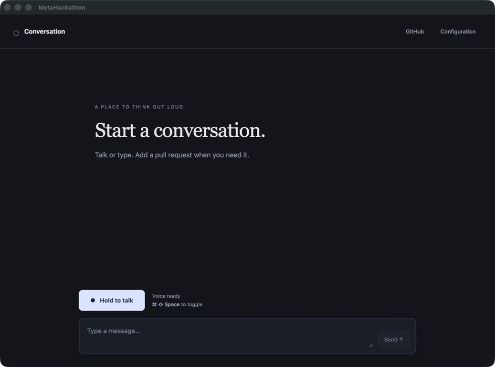

# V1 acceptance — 2026-10-27

V1 opens an empty real conversation. Talking and typing require no pull request, demo load,
or fixture. GitHub context is optional. The renderer startup graph excludes the old review
workspace and fixtures; the visible stylesheet shrank from about 46 KB to 7.4 KB.

Use the running app, or launch from `hack/integration`:

```sh
bun run build
bun run --filter @metahackathon/desktop preview
```

Wait for **Voice ready**, hold the talk button until **Listening**, speak and release.
**Command–Shift–Space** toggles capture even while the message composer has focus.
**Stop/Escape** interrupts. Opening configuration or changing optional PR context does not
make speech depend on a review.

Saved keys and voice ID migrated into repository-root `.env`, with mode `0600`, ignored by
Git. Configuration opens that file and reloads changes. Existing explicit file values take
precedence; the old encrypted settings remain as a backup. Packaged apps can seed their
user-data `.env` from a supplied distribution file; see README.

## Verified

- 374 TypeScript tests, 18 Python voice tests, type-check, lint and build pass.
- Native V1 renderer/IPC check passes empty startup, greeting and follow-up without a PR,
  real conversation history, Stop cancellation/late-output suppression and isolated `.env`.
  This automated model transport is simulated and uses dummy credentials.
- Separate live checks with saved configuration pass real model response, ElevenLabs PCM
  generation and Meta final speech recognition.
- Full native live round trip passes: generated synthetic speech → WebRTC/Python → Meta STT
  → conversational agent → ElevenLabs TTS → decoded renderer PCM. The button test observed
  386 nonzero audio frames; the app-wide shortcut test with composer focus observed 316.
  Providers were live and the normal renderer sandbox remained enabled. No ambient microphone
  audio was recorded; the running app reports microphone permission as granted.
- Existing GitHub login connects and retrieves seven real open authored/review-requested PRs.
  Real context retrieval was validated. No GitHub writes were made; V1 has no posting tool.



[Machine-readable evidence](v1-acceptance.json) preserves the result summary. Native generated
reports are under `apps/desktop/out/`. Signing, notarization and clean-machine packaged
distribution remain separate release checks. The older browser-demo report is historical.
